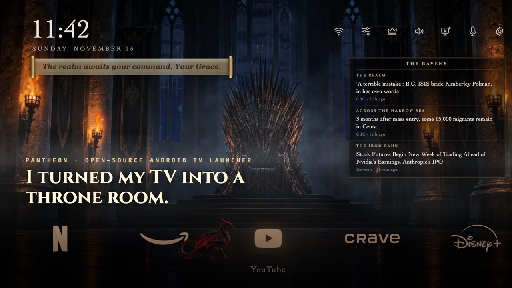
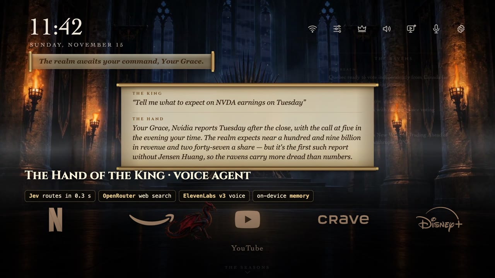
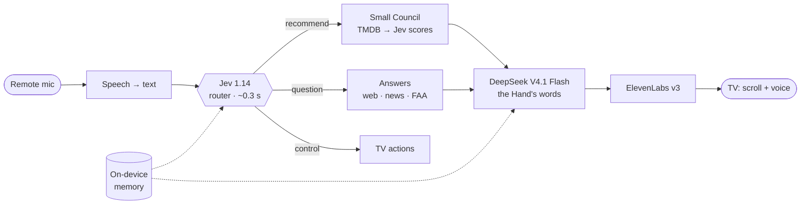

# Pantheon · TV of the Gods

**An open-source Android TV home screen that comes alive, with an AI agent that lives on the TV.**
A Game of Thrones throne room that follows the real weather and sun; Drogon as the cursor; an agentic remote that
picks what to watch from *your* services; and a Hand of the King who answers anything, in character, out loud.



▶ **[Watch the 54-second demo](https://github.com/jose16790/pantheon-tv-of-the-gods/releases/download/v1.0.0/brag.mp4)** ([vertical](https://github.com/jose16790/pantheon-tv-of-the-gods/releases/download/v1.0.0/brag-vertical.mp4)) · [Release v1.0.0](https://github.com/jose16790/pantheon-tv-of-the-gods/releases/tag/v1.0.0)

 
 
 

## What it does

- **A living home screen.** Real weather in the windows (rain, snow, fog, lightning), the room relit by the sun's
  actual position, the real moon phase, live torches, true OLED blacks. Ad-free: Pantheon replaces Google's home.
- **The Small Council, an agentic remote.** Time you have, genre seals, "something like…": DeepSeek reads the ask,
  TMDB finds what's on your installed apps in your country, **Jev scores 30 candidates in one ~0.3 s call**, and
  eight picks land in about 3–4 seconds with a line on why.
- **The Hand of the King, a voice agent.** Press the mic and ask anything: live web search, headlines, US flight
  delays, TV control. Jev routes each request in ~0.3 s; he answers in character with an expressive ElevenLabs v3
  voice (sighs, chuckles), and **remembers** you, on the device.
- **The Ravens.** National, world and finance headlines, each story sorted into its row by Jev.



## How it's built



- **The agent runs on the TV**: no server, no account; every model is an API call through one OpenRouter key.
- **A decision model decides; a language model speaks**: Jev for every bounded choice (routing, scoring, sorting),
  DeepSeek only for words. Cheaper, faster, and the probabilities give real thresholds and fallbacks.
- **Locked down**: keys never leave the TV and can only be set over adb (a receiver no other app can call); agent
  actions are a closed, typed set.

Read more: **[Architecture](docs/ARCHITECTURE.md)** (flows, GPU budget, cost model, security, failure modes) ·
**[Decision records](docs/adr/)**.

| Measured on a Google TV Streamer (MediaTek MT8696) | |
|---|---|
| Home scene, live fire + sky + weather | ~42 fps (GPU 6–9 ms/frame) |
| Voice routing (Jev) | ~0.3 s · ≈ $0.00002 |
| Small Council: ask → 8 cards | ~3–4 s · ≈ $0.0005 a pick |
| Spoken answer with web search | ≈ $0.01 |

## Quick start

You need a Mac or Linux machine and a Google TV on the same Wi-Fi.

```bash
git clone https://github.com/jose16790/pantheon-tv-of-the-gods.git && cd pantheon-tv-of-the-gods && ./install.sh
./scripts/agent-keys.sh      # optional: OpenRouter + TMDB (+ ElevenLabs) keys for the agent
./test.sh                    # the checks
```

Everything else (themes, voice commands, the sleep timer, your own music, testing hooks) is in
**[the guide](docs/GUIDE.md)**.

## Project

[Contributing](CONTRIBUTING.md) · [Security](SECURITY.md) · [Changelog](CHANGELOG.md) · [Notices](NOTICE.md)

Pantheon and its Game of Thrones theme are designed and built by **Jose** ([jose16790](https://github.com/jose16790)).
The Hogwarts theme and the home-screen base come from [hogwarts-tv-home](https://github.com/ikevinadams/hogwarts-tv-home)
by **ikevinadams** (MIT), extended by Pantheon; the agentic-remote idea follows [couch-tv](https://github.com/Seagey/couch-tv)
by **Seagey** (MIT).

> Unofficial, non-commercial fan project. Not affiliated with HBO, Warner Bros., Disney, Google or the app makers
> whose logos the dock shows. Game of Thrones and its names are trademarks of their owners; the theme's art, sound
> and code are original. Code and Pantheon's own art: [MIT](LICENSE).
