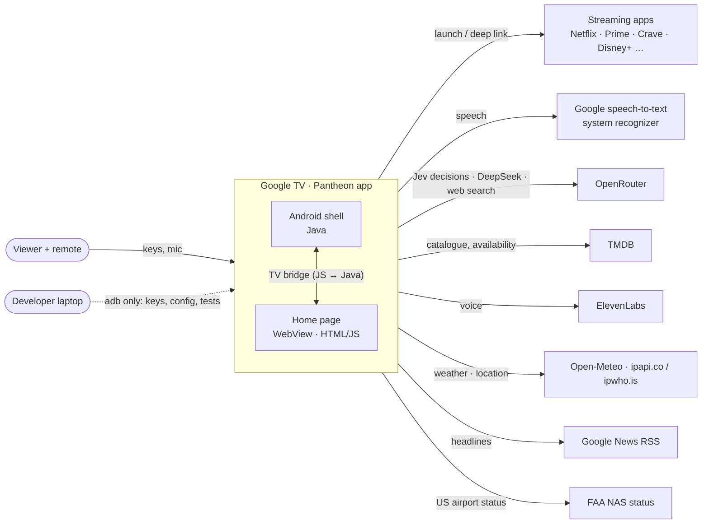
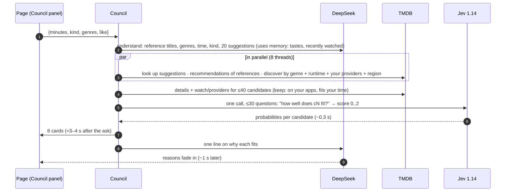

# Pantheon architecture

Pantheon is an Android TV home screen with a live, themed scene and an agent that runs **on the TV itself**: no
server, no account, no background service to keep alive. This document is the map: what runs where, how the pieces
talk, what leaves the device, what it costs, how it fails, and why it's built this way. Decisions are recorded
in [docs/adr](adr/).

## 1. Context



## 2. Containers

| Layer | What | Where |
|---|---|---|
| **Android shell** | `MainActivity`: a full-screen WebView and the `TV` JavaScript bridge (launch apps, open titles, theme, keyboard, weather, news, agent) | `android/app/src/main/java/…/MainActivity.java` |
| | **Home takeover:** `home/HomeWatch` (accessibility service) brings Pantheon forward whenever Google's home appears; `HomeGuard` repairs it after updates / force-stops; `CrashGuard` stands it aside after repeated crashes | `home/` |
| | **Voice:** `voice/VoiceAgent` (system recognizer, in-app fallback), `voice/LocalCommands` (instant, offline commands), `voice/Actions` (executes typed actions) | `voice/`, `assist/` |
| | **Agent:** `Agent` (entry point) → `Council` (recommender), `Memory`, `Speaker` (voice out), `Persona`, `OpenRouter` (Jev decisions + chat), `Tmdb`, `Services` (installed apps ↔ TMDB providers) | `agent/` |
| | **Feeds:** `weather/Weather` (location + Open-Meteo, 15 min), `news/News` (Google News, Jev-sorted rows, 15 min) | `weather/`, `news/` |
| | **Control:** `control/AdbControl`, the only configuration / test channel (adb-only, see §6) | `control/` |
| **Home page** | `index.html`: the shell (dock, sections, remote navigation, mascot) **inherited from hogwarts-tv-home** and extended through hooks | `home/index.html` |
| | `core/`: theme engine, weather maths, headlines, the Council panel, the conversation scroll, the sleep countdown, the Ledger | `home/core/` |
| | `themes/<id>/`: each theme self-contained (scene script, art, sprites, sound, the tools that made them) | `home/themes/got/`, `home/themes/hogwarts/` |
| **Build** | `build.sh` copies `home/` into the app's assets (`android/app/src/main/assets/www`, which mirrors it) with TV-sized, pre-shaded art; `install.sh` sets a TV up end to end | root |

## 3. Key flows

### Voice: "Tell me what to expect on NVDA earnings on Tuesday"

```mermaid
sequenceDiagram
  autonumber
  participant R as Remote mic
  participant V as VoiceAgent
  participant L as LocalCommands
  participant A as Agent
  participant J as Jev 1.14 (OpenRouter)
  participant D as DeepSeek V4.1 Flash (OpenRouter + web)
  participant S as Speaker
  participant E as ElevenLabs v3
  participant P as Page (scroll)
  R->>V: speech → text (system recognizer)
  V->>L: simple command? (open app, volume, pause…)
  L-->>V: no
  V->>P: "The King: …"
  V->>A: voice(text)
  A->>J: route? {said, recent turns, picks on screen} (~0.3 s)
  J-->>A: question (p=0.96)
  A->>S: recorded "one moment" line (instant, cached asset)
  A->>D: persona + memory (system) · question (user) · web plugin · headlines/FAA if relevant
  D-->>A: "[clears throat] Your Grace, …" (≤35 words)
  A->>S: say(line)
  S->>E: TTS (v3 performs the cues; cached by hash)
  E-->>S: mp3
  S->>P: line + start/duration → words appear as spoken
  A->>A: memory: keep the exchange; learn facts (background)
```

Routes Jev chooses between: **recommend** (→ the Council), **play_title** (find it, open it in the app that has it),
**control** (→ typed actions: launch, key, volume, theme, sleep, search), **question** (as above), **memory**
(remember / forget / recall). Low confidence falls back to the chat model with the full action schema.

### The Small Council: "45 minutes, comedy or sci-fi, like Severance but funnier"



### Headlines

Every 15 minutes: national, world, business and a markets/economy search feed (~75 stories) → **one or two Jev
calls** classify each as national / world / finance / other (finance needs p ≥ 0.75; quote pages and listicles are
"other") → each row takes its own kind. Without the agent's key: the feeds as they are, plus a finance word list.

## 4. Rendering on a TV GPU

The target is a Google TV Streamer (MediaTek MT8696, 4 GB). Measured on the device:

| | |
|---|---|
| Home scene, settled (GoT, day or night) | ~42 fps; GPU ~6–9 ms/frame, so CPU-bound |
| During a 3 s lighting crossfade | ~40 fps |
| Memory (whole app) | ~120 MB PSS |

How it stays there: no canvas blend modes (the GPU can't afford them; fire and flames are pre-multiplied sprite
sheets); the sky is a half-resolution canvas under a glass mask; fog and dust are CSS transforms (compositor-only);
torches draw at 30 fps; the whole scene pauses while a full-screen panel is open; backdrops are baked at TV size
with their static shading and an **OLED black point** (near-blacks taken to true black per picture,
`home/tools/oled.py`) so nothing is computed per frame that could be computed once.

## 5. Cost model (per use, at current OpenRouter / ElevenLabs prices)

| Action | Calls | Cost |
|---|---|---|
| Council pick | DeepSeek (understand) + TMDB (free) + **Jev** (30 scores) + DeepSeek (reasons) | ≈ $0.0005 |
| Voice routing | **Jev**, one choice | ≈ $0.00002 |
| Spoken answer | DeepSeek + web plugin (~4 results) | ≈ $0.007–0.01 |
| Voice | ElevenLabs v3, ~1 credit per character; recorded lines and repeats are free (cached) | plan credits |
| Headlines refresh | **Jev**, ~75 classifications | ≈ $0.00003 |

## 6. Security and privacy

**Trust boundary: the TV.** Keys and memory never leave it except as the requests below.

| Data | Leaves to | Why |
|---|---|---|
| Your words (after speech-to-text) | OpenRouter (Jev, DeepSeek) | routing, answers |
| Remembered facts, recent turns | OpenRouter | context for answers and picks |
| Approximate location (from IP) | Open-Meteo | weather |
| Country code | TMDB, Google News | what's available / national news |
| The Hand's lines | ElevenLabs | voice |

- **Keys:** stored in the app's private storage; `android:allowBackup="false"`; never logged; never in the repo or the
  APK. Set from a laptop with `scripts/agent-keys.sh`, which checks them first.
- **Control channel:** the main activity must stay exported (it's the home screen), so it accepts only harmless
  requests (theme, go home). Keys, configuration and test commands go to `control/AdbControl`, an exported receiver
  guarded by `android.permission.DUMP`, which adb's shell holds and **no third-party app can be granted**: no other app
  on the TV can swap the keys, spend credits or make the agent act. ([ADR 0004](adr/0004-adb-only-control-channel.md))
- **Agent actions** are a closed, typed set (launch, key, volume, search, theme, sleep): no shell, no payments, no
  sign-ins, no free-form intents.
- **Memory:** bounded (40 facts, 6 turns / 15 min), told never to store passwords, money or health details,
  visible and editable on screen (the Ledger, `core/ledger.js`: strike a fact, forget what you've watched, forget
  everything), and erasable by voice ("forget everything").
- **Repository:** secret scanning and push protection on; history scanned clean.

## 7. Failure modes

| Failure | Behaviour |
|---|---|
| No agent keys | Council and Hand say so; voice falls back to local commands; headlines unsorted (word list) |
| Jev unavailable | Council ranks by rating × votes; voice routes to the chat model with every action |
| DeepSeek unavailable | Qwen 3.7 Flash as backup |
| ElevenLabs fails / no key / out of credits | The TV's own text-to-speech reads the same words |
| No network | Cached weather and headlines; scene keeps running; agent says the ravens didn't return |
| Pantheon crashes twice in 5 min | `CrashGuard` stands the Home watch aside for 10 min (the TV never gets stuck) |
| Android detaches the accessibility service (update, force-stop) | `HomeGuard` re-attaches it at boot, on update, on open, on screen-on |

## 8. Testing

`./test.sh` (local; no CI): syntax of every page and shell script; **Java unit tests** for the agent's pure logic
(spoken-text cleaning, cue handling, provider matching, personas, finance fallback); **JavaScript tests** checking
the weather wizard against known astronomy (solstice sun heights within 0.8°, April 2024 moon phases) and weather
classification. Behaviour on the device is verified on the TV itself (adb screenshots / recordings, logcat), with
test hooks on the adb-only channel (`ask`, `council`, `wx`, `sleep_test`, `fresh_conversation`).

## 9. Provenance

`home/index.html` and the Hogwarts theme come from [hogwarts-tv-home](https://github.com/ikevinadams/hogwarts-tv-home)
(MIT). Pantheon extends that file through small hooks rather than rewriting it; everything new is in modules:
`home/core/`, `home/themes/got/`, and on the Java side `agent/`, `control/`, `home/`, `news/`, `weather/`, `theme/`.
